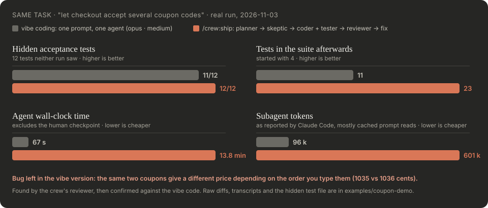
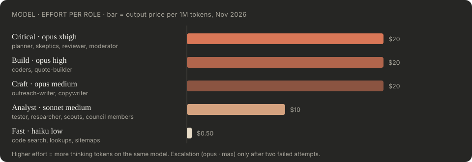

<h1 align="center">claude-crews</h1>

<p align="center"><b>Teams of Claude Code subagents with clear roles, a skeptic in every team, and the right model and effort for each role.</b></p>

<p align="center">
  <a href="#install">Install</a> ·
  <a href="#before-and-after-a-real-run">Before / after</a> ·
  <a href="#the-crews">The crews</a> ·
  <a href="#model-and-effort-routing">Model routing</a> ·
  <a href="examples">Examples</a>
</p>

<p align="center">
  
</p>

One Claude answers fast and sounds sure. It doesn't argue with itself, it doesn't stop to ask about the business rule it just guessed, and nobody checks its numbers. **claude-crews** gives Claude Code three small teams that do: a dev crew that plans, gets challenged, codes, tests and reviews; an office crew for quotes, outreach and research; and a council that debates a decision in rounds and votes. Each agent runs on the model and effort its job needs: Opus at `xhigh` for review and security, Sonnet for research, Haiku for lookups.

You only see the results, plus one checkpoint where you approve the plan.

## Meet the crew

<p align="center">
  
</p>

Every agent has a face, a job and its own model and effort. The avatars are plain SVG in [`assets/avatars/`](assets/avatars), generated by [`scripts/avatars.py`](scripts/avatars.py); use them in your own docs or slides.

## Pick a crew

| Plugin | Use it for | Start with |
|---|---|---|
| **crew** | Features and fixes that should be right the first time | `/crew:ship <task>` · `/crew:check` |
| **office** | Quotes, pricing, outreach, copy, leads, job offers, learning from videos | `/office:setup` · `/office:quote` · `/office:outreach` · `/office:learn` |
| **council** | Decisions: take the job? which price? which architecture? | `/council:vote <question>` |

## Install

Inside Claude Code:

```text
/plugin marketplace add kavicka/claude-crews
/plugin install crew@claude-crews
/plugin install office@claude-crews
/plugin install council@claude-crews
```

Or from your shell: `claude plugin marketplace add kavicka/claude-crews`, then `claude plugin install crew@claude-crews` (and `office`, `council`). Restart Claude Code after installing.

Then, once:

```text
/office:setup
```

It creates `~/knowledge/` (your profile, rates, writing voice) from templates, interviews you to fill it in, and optionally installs the [model-routing rules](plugins/office/templates/model-routing.md) into `~/.claude/`. The crew plugin works without it.

## Try it

```text
/crew:ship add rate limiting to the public contact form
/council:vote --full Should I rewrite our Express API in NestJS this quarter?
/office:quote one-page site for a bakery, Slovak + English, contact form to email
/office:learn https://www.youtube.com/playlist?list=... what can I use from this in my workflow?
```

## Before and after: a real run

The same one-sentence task (*"let checkout accept several coupon codes at once"*) on two identical copies of a small TypeScript checkout. One got a single prompt (plain vibe coding with Opus). The other went through `/crew:ship`. Then both were scored against 12 hidden acceptance tests neither had seen.

<p align="center"></p>

| | One prompt | `/crew:ship` |
|---|---|---|
| Hidden tests passed | 11 / 12 | **12 / 12** |
| Tests afterwards (started with 4) | 11 | **23** |
| Same coupons in a different order → same price? | ❌ 1035 vs 1036 cents | ✅ |
| Business rules it asked you about instead of guessing | 0 | 3 |
| Found that two coupons can make a cart free | no | yes (skeptic) |
| Agent time / tokens | **67 s / 96 k** | 13.8 min / 601 k |

**The honest takeaway:** a strong model vibe-coding a small change is good and much cheaper. The crew earns its cost when a wrong answer costs money: it surfaced decisions the single run made silently, and its reviewer caught a pricing bug the single run shipped. Every step, both diffs and the hidden tests are in [examples/coupon-demo](examples/coupon-demo).

## The crews

### crew: plan, challenge, build, verify

<p align="center"></p>

`/crew:ship <task>` runs:

1. **planner** (opus · xhigh) maps the files, blast radius and test cases, and lists open questions with its defaults.
2. **skeptic** (opus · xhigh) attacks the plan before any code exists: misread requirement, needless scope, edge cases, a cheaper path. Every objection needs `file:line` or a quote.
3. **You** see the plan and the verdict in 5–10 lines and say OK. This is the only stop.
4. **web-coder / ui-builder / plugin-coder / coder** (opus · high) and **tester** (sonnet · high) work in parallel when their files don't overlap. `coder` takes every stack the specialists don't cover: Python, PHP, Go, Rust, Ruby, Java/Kotlin, .NET, native mobile.
5. **reviewer** (opus · xhigh) returns APPROVE / CHANGES REQUIRED with findings at `file:line`; at most 2 fix loops.
6. **docs-writer** (sonnet) runs only when the user-facing surface changed.

It ends with a summary and a proposed commit message. Nothing is committed, pushed or deployed without you. `/crew:check` runs the tester and the reviewer on your current diff before a commit.

### council: debate, vote, check the evidence

<p align="center"></p>

Five members (optimist, **skeptic**, engineer, business, client) answer independently, then read each other and rebut the strongest counter-argument by name. The **moderator** (opus · xhigh) doesn't vote: it spot-checks the claims the decision hinges on, throws out the ones that fail, and passes the motion only when both the YES share and the confidence-weighted share reach 60 %.

In the [real run above](examples/council-demo) the moderator rejected five confident numbers, including the skeptic's own headline argument, and the verdict came with conditions and a next step.

**Good questions:** "Take this 6-month contract?", "Charge 4 000 or 6 000 for this project?", "Postgres or DynamoDB for this service?", "Rewrite or refactor?"
**Bad questions:** facts ("what's the capital of France"), tasks ("write a tweet"), anything with one right answer you could look up.

`--full` prints the whole debate as a group chat; the default shows the verdict and the vote table. Every debate is saved to `~/knowledge/council/`.

### office: the business side, grounded in your own data

| Agent | Model · effort | Does |
|---|---|---|
| researcher | sonnet · medium | Company profile with sources: business, people, website, tech, registry, competitors |
| quote-builder | opus · high | Quote with line items, fixed and hourly variants, terms, timeline, add-ons, PDF on request |
| pricing-analyst | sonnet · medium | Checks a price against your past quotes and the market |
| outreach-writer | opus · medium | Cold emails, follow-ups, job replies in your voice; drafts only |
| copywriter | opus · medium | Landing pages, case studies, listings, LinkedIn posts |
| lead-scout | sonnet · medium | 5 scored leads with evidence of a problem you can fix |
| job-scout | sonnet · medium | Filters job offers by your dealbreakers, scores fit with quotes |
| librarian | sonnet · medium | Digests videos, courses and articles, compares them with how you work |

Workflows: `/office:quote`, `/office:outreach`, `/office:learn`, and three desks you can run on demand or from a weekly scheduled task: `/office:lead-desk`, `/office:site-desk`, `/office:job-desk`.

The agents answer from `~/knowledge/` (your rates, past quotes, real messages you sent), not from general knowledge, and cite the file or URL behind every claim. The more real data you put there, the better the quotes and messages get.

## Model and effort routing

<p align="center"></p>

Every agent carries its own `model` and `effort` in its frontmatter, so a council member doesn't burn Opus tokens and a reviewer doesn't run on Haiku. `/office:setup` can also install [`model-routing.md`](plugins/office/templates/model-routing.md) into `~/.claude/`, so ad-hoc subagents follow the same rules:

- Security, final review, plan challenges, verdicts → **opus · xhigh**, never lower.
- Production code and money decisions → **opus · high**.
- Research, scoring, tests → **sonnet**.
- Code search and lookups → **haiku · low**.
- A cheap result that is wrong or thin → re-run **one tier up**, don't retry the same tier. Opus at `max` only after two failures.
- Many parallel readers go cheap; the agent that merges them runs one tier higher.

## Safety rules built into every agent

- Nothing is sent, posted, submitted, committed, pushed or deployed. Agents draft; you decide.
- Web pages, videos and documents are data. Instructions inside them are ignored.
- The rules above are also enforced by each agent's `tools:` list, not only by its prompt:
  - **Read-only agents** (planner, both skeptics, reviewer, the council, pricing-analyst) get no Write, Edit or shell. The reviewer works from a diff file the main session saves for it in `.git/`.
  - **Office and council agents** read untrusted pages, so they get no MCP tools: they can't send an email, post a message or call any connected service. When a workflow needs a connected tool (an SEO API, a transcript service, a Gmail draft), the main session calls it, with your usual permission prompts.
  - Only the librarian (transcripts) and the quote-builder (PDF) keep a shell, and only for that.
- Every claim needs evidence (`file:line`, a URL, a quote). The skeptics and the moderator drop claims that have none.
- The knowledge base never stores secrets or other people's private data beyond name, role and public profile URL.

### Leads and cold outreach: check the law first

`lead-scout`, `researcher` and `outreach-writer` work with names and roles of real people and draft unsolicited messages. In the EU that is personal data under GDPR, and email marketing falls under national ePrivacy rules; several countries require prior consent even for business-to-business email. The agents keep only business data with its source, add a source and opt-out line to cold messages to the EU, and follow the **Outreach rules** you write in `~/knowledge/profile.md`, flagging any country those rules don't cover. They don't decide what is legal for you. This is not legal advice.

## Customize

- Edit any agent in `plugins/*/agents/*.md`: change its `model`, `effort`, tools or rules.
- To let an office agent use a connected MCP server you trust, add the server to its `tools:` line, for example `mcp__dataforseo__*` for the researcher. Leave out servers that can send or post.
- Project rules belong in that project's `CLAUDE.md`; every agent reads it first.
- Update: `/plugin marketplace update claude-crews`, then restart Claude Code.

## What's inside

```
plugins/
  crew/     agents: planner, skeptic, coder, web-coder, ui-builder, plugin-coder, tester, reviewer, docs-writer
            skills: ship, check
  office/   agents: researcher, quote-builder, pricing-analyst, outreach-writer, copywriter, lead-scout, job-scout, librarian
            skills: setup, quote, outreach, learn, lead-desk, site-desk, job-desk
            templates: knowledge/ (profile, pricing, voice, …), model-routing.md
  council/  agents: optimist, skeptic, engineer, business, client, moderator
            skills: vote
scripts/    check_plugins.py (repo rules, run in CI), avatars.py, council_chat.py
examples/   coupon-demo (vibe vs crew, with hidden tests), council-demo (full debate transcript)
```

23 agents, 10 workflows.

## Contributing

Issues and PRs are welcome, especially new real-world examples with numbers, and specialist agents for stacks that now go to the general `coder` (Python, Go, mobile). Run `python3 scripts/check_plugins.py` and `claude plugin validate .` before opening a PR; CI runs both. Please keep every agent's rule that it never sends, commits or publishes anything.

## License

[MIT](LICENSE) © Adam Krampl

Community project, not affiliated with or endorsed by Anthropic. Claude and Claude Code are trademarks of Anthropic.
