# A bakery goes online: one story through all three crews

**Kvások & syn** is a family bakery in Bratislava. It takes about 70 pre-orders a week by phone and Instagram, misses calls in the morning rush, and wants customers to order online and pick a time to collect. **Lucia** built its website two years ago and is asked to do this too. She uses claude-crews in the order a real project goes:

| | Command | Question it answers |
|---|---|---|
| 1 | `/council:vote Should the bakery launch with online payments or start with pay-at-pickup?` | What should we build? |
| 2 | `/office:quote one-page online ordering site for a bakery, Slovak + English, contact form to email` | What does it cost, and on what terms? |
| 3 | `/crew:ship add online ordering with pickup time slots to the bakery website` | Build it, tested and reviewed. |

> **What is real and what isn't.** The bakery, its owner Jana, Lucia and every number about them are invented: see [knowledge/](knowledge) (Lucia's knowledge base) and [site/](site) (the bakery's website before the change). The runs are real: Claude Code with the plugins from this repository, recorded on 2026-11-04 by [record.py](record.py). When an agent asked a question, the answer was written by the person recording the example, playing Lucia; every question and answer is shown below as it was. The client persona in the council is an agent too, not Jana.

Each step has a full, readable log of the conversation: what Lucia typed, every brief the main session sent to an agent, and every agent's answer. Briefs are folded.

---

## 1 · Decide: online payments or pay at pickup?

<p align="center"></p>

**How they decided.** Five members answered independently, then each read the others and answered the strongest opposing argument by name. All five voted **NO** to card payments at launch in both rounds. The interesting part is *why* the verdict came out the way it did:

- In round 1 everyone, the skeptic included, argued that big cakes "already carry a 30 % deposit". In round 2 the skeptic pointed at line 18 of the client file: that deposit is taken **in the shop**. Cakes ordered online would skip it, right before Christmas. That turned "payments later" into "pay at pickup, plus a stopgap for cakes".
- The client persona first asked for a launch date that didn't depend on Jana's texts arriving, then dropped it after the others pointed to Lucia's own rule against promising dates before content arrives.
- The moderator didn't vote. It checked the claims the decision rests on and threw out six, including a card fee off by half (0.46 €, not 0.30 €), a date the simulated client made up, and a project cited as a "payments delay" that had no payments.

**What it asked you.** It ended with six questions to put to the client before quoting:

> 1. Is the 3 000 € including or excluding VAT?
> 2. On what date will texts and photos arrive? Please confirm in writing.
> 3. Last December, how many cakes were never picked up, split into over and under 50 €?
> 4. Can she ask her accountant whether online deposits have to be recorded in eKasa, and how?
> 5. Does she want English at launch?
> 6. Until online deposits exist, is it OK that big cakes are confirmed only once the deposit is paid?

**What you got:** the verdict (REJECTED, 0 of 5 for payments at launch), a recommendation with an optional cake-deposit line of 400–500 €, and the debate logged to Lucia's knowledge base.

Files: [verdict as shown in chat](runs/council/1-answer.md) · [full debate log](runs/council/2026-11-04-bakery-online-payments-vs-pickup.md) · [whole conversation](runs/council/conversation.md) · 8 min · $2.53

---

## 2 · Quote: what does it cost?

<p align="center"></p>

**What it asked you, before doing anything.** The quote workflow stops when missing facts would move the price by more than 20 %. It asked six questions and offered defaults ([1-answer.md](runs/quote/1-answer.md)):

> 1. **Scope.** (a) A one-page site where orders arrive through the contact form as emails, roughly 1 650–1 800 €. (b) An order form with pickup slots on the existing site, roughly 3 000–3 600 €. (c) A different bakery.
> 2. **Payments.** Online, at pickup, or a deposit online only for cakes over 50 €?
> 3. **Admin.** An order list with a daily export (+400 €), or are emails enough?
> 4. **Content.** Will Jana supply the texts and photos?
> 5. **Deadline.** A reduced phase 1 by 1 December, or a later date?
> 6. **Language** of the quote?

**Lucia's answers** ([2-prompt.md](runs/quote/2-prompt.md)), after asking Jana the council's questions:

> (b) pickup slots; pay at pickup, as the council decided; email notifications plus a printable list for the morning shift; Jana sends texts and photos by 20 November; phase 1 live by 1 December; quote in Slovak. Jana: the 3 000 € is excluding VAT and she can go to 3 500 €; last December 9 cakes were never picked up, 6 of them over 50 €.

**How they decided.**

1. **quote-builder** priced it from the hours of the most similar past project: 72 h, **3 600 €**, 100 € over Jana's ceiling. It did not squeeze the price to fit; it listed what could be cut.
2. **pricing-analyst** and **skeptic** reviewed it in parallel.
   - The analyst returned **NEEDS INFO**. The florist project the hours came from ran 19 % over its net estimate, so the slots were underestimated. It also found that Lucia's own pricing file uses 20 % VAT, while Slovakia's standard rate has been 23 % since January 2025.
   - The skeptic, playing Jana's procurement person, found that nobody could cancel an order or mark a deposit as paid, so cancelled orders and unpaid cakes would still be baked: exactly last December's 9 lost cakes. It also noticed that the "cakes over 50 €" rule couldn't trigger, because the only cake on the online menu costs 38 € (`site/src/menu.ts:18`).
3. **quote-builder** revised once with both lists: phase 1 at **3 500 €** by moving menu photos to an add-on instead of discounting, big cakes stay by phone, and an optional phase 2 (500 €) adds a "cancelled" switch that frees the slot.

**What it asked you at the end.** Two things only Lucia can check: how the existing site actually sends email in production (in the repository the contact form only prints to the console), and whether to fix the VAT rate in her pricing file.

**What the client gets:** [the quote, in Slovak](runs/quote/2026-11-04-kvasok-a-syn.md), with phases, line items and hours, payment terms, timeline and assumptions to confirm. Nothing was sent; Lucia sends it.

Files: [whole conversation](runs/quote/conversation.md) · [client file after the run](runs/quote/client-file-after.md) (the main session recorded the decisions from Lucia's call) · 13 min · $3.01

---

## 3 · Build: online ordering with pickup slots

CREW_SECTION

---

## Totals

| Step | Agents that ran | Questions to you | Time | Cost |
|---|---|---|---|---|
| Council | optimist, skeptic, engineer, business, client ×2 rounds, moderator | 6 (for the client) | 8 min | $2.53 |
| Quote | quote-builder ×2, pricing-analyst, skeptic | 6 before, 2 after | 13 min | $3.01 |
| Crew | CREW_TOTALS |

Costs are what Claude Code reports at list price, subagents included.

## Re-run it

```bash
cd examples/bakery
python3 record.py setup           # a fresh home with Lucia's knowledge base and the site, outside the repo
python3 record.py run council
python3 record.py run quote       # stops with questions
python3 record.py answer quote my-answers.md
python3 record.py run crew        # stops at the checkpoint
python3 record.py answer crew my-answers.md
python3 extract.py                # readable conversation logs
```

Your runs will differ: the agents are not deterministic, and your answers steer them.
