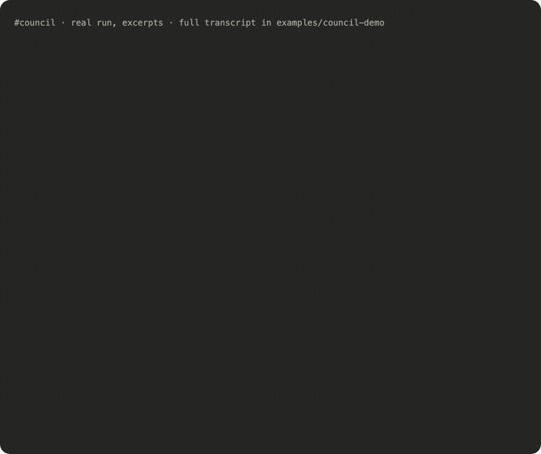

# Council demo: "Should Maya take the 6-month contract?"

A real, unedited `/council:vote --full` run from 2026-11-03. Maya is fictional; the agents were told so and had no access to anyone's personal files.

## The question

- Maya, freelance full-stack web developer, 7 years of experience, based in Lisbon.
- Today: three retainer clients, together 6 000 €/month for about 25 h/week. Client A 2 800 €/month (3 years together), client B 2 000 €/month (1 year), client C 1 200 €/month (6 months, demanding).
- Offer: a fintech wants her full-time for 6 months, remote, 11 000 €/month, start in 3 weeks, possible extension. React + Node, payments work.
- To take it she must drop client C and ask A and B to pause for 6 months. A said "maybe, we'd need someone in the meantime"; B hasn't answered.
- Savings: 4 months of expenses. Goal for next year: raise rates and productize a small SaaS.

## How the votes moved

| Member | Model · effort | Round 1 | Round 2 | What changed its mind |
|---|---|---|---|---|
| 🟢 optimist | sonnet · medium | YES 70 | YES 68 | Client A: "a pause turns into goodbye by month 3" |
| 🔴 skeptic | opus · xhigh | NO 65 | NO 55 | Found its own double-counting (33 600 € → 16 800 €), dropped the hourly-rate objection |
| 🛠️ engineer | sonnet · medium | YES 70 | YES 66 | Skeptic's point on losing A |
| 💰 business | sonnet · medium | YES 68 | YES 62 | Skeptic's point on losing A |
| 👤 client | sonnet · medium | YES 62 | YES 60 | Skeptic: A is the real asset |
| ⚖️ moderator | opus · xhigh | — | **PASSED 80 % · weighted 82 %** | Rejected 5 claims that failed the evidence check |

**Outcome:** take it only with a paid bridge for client A and a notice clause; otherwise decline. Full reasoning in [verdict.md](verdict.md).

## What a single answer would have missed

The moderator's evidence check threw out five confident-sounding numbers, among them the skeptic's own round-1 headline argument and a retainer total that matches no combination of clients. A single model answering in one pass has no second reader to catch those.

## Files

- [round1.md](round1.md): independent positions, in parallel
- [round2.md](round2.md): rebuttals, each member answers the strongest opposing argument by name
- [verdict.md](verdict.md): the moderator's verdict, open disagreements and failed evidence

## Cost of this run

11 subagent runs (5 + 5 + moderator), about 2.6 minutes of wall-clock time with parallel rounds. Claude Code reported 894 k subagent tokens in total; most of that is each agent's system prompt and tool definitions being read again (cache reads), not new text.
