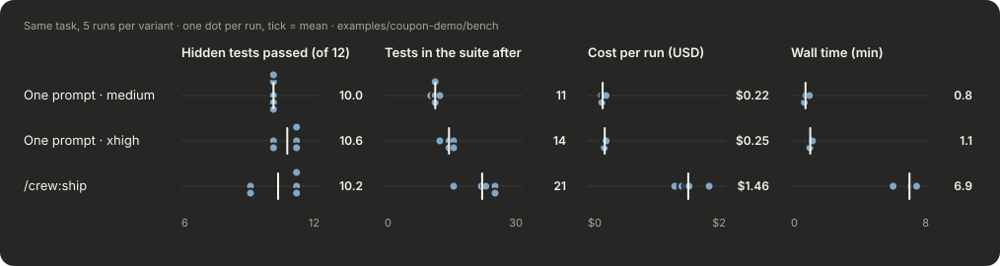

# Coupon demo: one prompt vs `/crew:ship`

One small task on a tiny TypeScript checkout:

> Let checkout accept several coupon codes at once: `checkout(items, codes?: string | string[], now?)`. A single string must keep working.

Each result is scored against 12 **hidden** acceptance tests ([hidden/acceptance.test.ts](hidden/acceptance.test.ts)) that no run sees: four test what the task states, four what the existing code implies, four things nobody mentioned (duplicates, negative totals, fractional cents). The base code passes 2 of 12.

## Results: 5 runs per variant



| | One prompt · medium | One prompt · xhigh | `/crew:ship` |
|---|---|---|---|
| Hidden tests passed (mean, range) | 10.0 (10–10) | **10.6** (10–11) | 10.2 (9–11) |
| Runs with all 12 | 0 / 5 | 0 / 5 | 0 / 5 |
| Tests in the suite afterwards (started with 4) | 11 | 14 | **21** |
| Price depends on the order of the codes | 4 / 5 runs | 0 / 5 | 0 / 5 |
| Cost per run | **$0.22** | $0.25 | $1.46 |
| Wall time per run | **0.8 min** | 1.1 min | 6.9 min |

Every run's patch, transcript and score: [bench/results](bench/results/SUMMARY.md). How the runs were made and what they can't show: [bench/README.md](bench/README.md).

### What this says

- **On the hidden tests, the crew did not beat one prompt at the same effort.** One agent at `xhigh` averaged 10.6, the crew 10.2. The single run in the first version of this page (crew 12/12, one prompt 11/12) did not hold up when repeated.
- **Effort matters more than the crew for correctness here.** At `medium`, 4 of 5 single runs made the price depend on the order of the coupon codes. At `xhigh`, none did. Neither did any crew run.
- **The crew writes more tests**, about 21 against 14, and every crew run ended with an explicit list of the decisions it took without the user.
- **Two crew runs scored 9 / 12 for a reason worth knowing.** Their skeptic held the plan to "a single string must keep working" and blocked rounding and the zero cap for single codes. That kept negative totals and fractional cents (C2–C4). Both runs flagged this in the summary as a decision the user must take. In the benchmark nobody answers the checkpoint; the operator note takes the planner's defaults. With a person at the checkpoint, that is the moment the question gets answered.
- **Cost:** the crew costs about 6× more and takes about 6× longer than one prompt at `xhigh`.

**So:** for a small, well-specified change like this, one prompt at `xhigh` is the better deal. The crew pays off when the open questions are real business decisions you want to see before the code exists, as in the [bakery example](../bakery), and when you want a reviewer and a larger test suite. That is a judgement call, not something this benchmark proves.

## The original run (2026-11-03)

The first version of this page reported one run per variant. Its diffs were saved through a compacting tool and couldn't be applied; [original-run/](original-run/) has the recovered code, real patches and scores, and the step-by-step crew log is in [crew-run/](crew-run/):

| Step | Agent | Model · effort | Time |
|---|---|---|---|
| 1 | [planner](crew-run/1-plan.md) | opus · xhigh | 149 s |
| 2 | [skeptic](crew-run/2-skeptic.md) | opus · xhigh | 417 s |
| 3 | [checkpoint](crew-run/3-checkpoint.md) | you | < 1 min |
| 4 | [web-coder ∥ tester](crew-run/4-implement-and-test.md) | opus · high ∥ sonnet · high | 76 s ∥ 61 s |
| 5 | [reviewer](crew-run/5-review.md) | opus · xhigh | 133 s |

## Run it yourself

```bash
cd examples/coupon-demo/base && npm install
cp ../hidden/acceptance.test.ts src/ && npx vitest run   # 2/12 on the base code
```

Apply a result to a fresh copy of `base/` with `git apply`, for example `../bench/results/crew-1/changes.patch` or `../original-run/vibe.patch`, and run the hidden tests again. To repeat the whole comparison, see [bench/](bench/).
