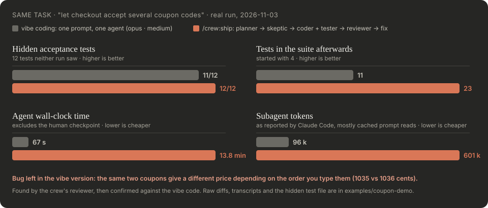

# Coupon demo: vibe coding vs `/crew:ship`

One real task, run twice on identical copies of a tiny TypeScript checkout (2026-11-03, Claude Opus 5.5 / Sonnet 5.5):

> Let checkout accept several coupon codes at once: `checkout(items, codes?: string | string[], now?)`. A single string must keep working.

- **Vibe:** that sentence, given to one general-purpose agent (opus · medium, the Opus default). No plan, no review.
- **Crew:** the same sentence through `/crew:ship`: planner → skeptic → checkpoint → coder and tester in parallel → reviewer → one fix loop.

Afterwards both results were scored against 12 **hidden** acceptance tests ([hidden/acceptance.test.ts](hidden/acceptance.test.ts)) that neither run saw. Four test what the task states, four what the existing code implies, four things nobody mentioned (duplicates, negative totals, fractional cents).

## Results



| | Vibe | Crew |
|---|---|---|
| Hidden tests passed | 11 / 12 | **12 / 12** |
| Tests in the suite afterwards (started with 4) | 11 | **23** |
| Order-independent price for the same coupons | ❌ 1035 vs 1036 cents | ✅ |
| Business decisions surfaced to the user | 0 | 3 (compound vs add, stacking limit, rounding change on the single-code path) |
| Free-cart risk (GIFT25 + SAVE5 on a 30 € cart) | not mentioned | found by the skeptic, accepted as a follow-up |
| Agent runs | 1 | 6 |
| Agent wall-clock time | **67 s** | 13.8 min |
| Subagent tokens reported | **96 k** | 601 k |

Base code before either run: 2 / 12 hidden tests.

### Honest reading

- Opus 5.5 vibe-coding is good. It fixed the two latent bugs (negative totals, fractional cents) on its own and passed 11 of 12 hidden tests. Its one hidden-test failure, C1, is a design choice: it rejects a duplicate code instead of ignoring it. Both are defensible.
- What it shipped silently is a pricing bug: the same coupons in a different order give a different total. The crew's planner pinned the order, the reviewer demanded a test that would catch a regression, and a check against the vibe code confirmed the bug.
- The crew also turned three silent assumptions into questions for the user, and found that two coupons can make a cart free.
- It cost ~6× the tokens and ~12× the agent time. **For a 20-line change you'd review yourself, vibe-code it. When a wrong answer costs money, use the crew.**

## Files

| Path | What |
|---|---|
| [base/](base/) | the starting code (4 tests) |
| [hidden/acceptance.test.ts](hidden/acceptance.test.ts) | the 12 hidden tests |
| [vibe.diff](vibe.diff) | everything the vibe run changed |
| [crew.diff](crew.diff) | everything the crew run changed |
| [crew-run/](crew-run/) | each crew step: [plan](crew-run/1-plan.md), [skeptic](crew-run/2-skeptic.md), [checkpoint](crew-run/3-checkpoint.md), [code + tests](crew-run/4-implement-and-test.md), [review + fix](crew-run/5-review.md) |

## Per-agent numbers (crew)

| Step | Agent | Model · effort | Time | Tokens |
|---|---|---|---|---|
| 1 | planner | opus · xhigh | 149 s | 97 k |
| 2 | skeptic | opus · xhigh | 417 s | 109 k |
| 3 | checkpoint | you | < 1 min | — |
| 4 | web-coder ∥ tester | opus · high ∥ sonnet · high | 76 s ∥ 61 s | 99 k + 98 k |
| 5 | reviewer | opus · xhigh | 133 s | 107 k |
| 6 | tester (fix loop) | sonnet · high | 51 s | 91 k |

Token counts are what Claude Code reports per subagent; most of each is the agent's system prompt and tool definitions read from cache, so the dollar cost is far below a naive tokens × price estimate.

## Run it yourself

```bash
cd examples/coupon-demo/base && npm install
cp ../hidden/acceptance.test.ts src/ && npx vitest run   # 2/12 on the base code
```
Then apply `vibe.diff` or `crew.diff` to a fresh copy (`git apply ../crew.diff`) and run the hidden tests again.
